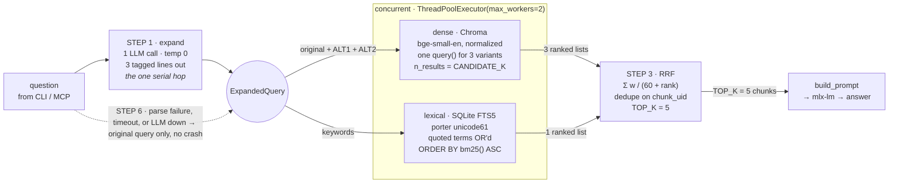
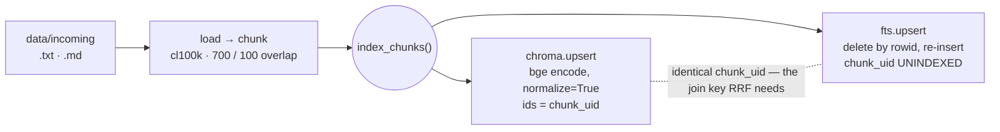

# Hybrid retrieval for a 1.7B model

Design spec for STEPS 1–3, 5 and 6 — query expansion, full-text search, RRF fusion,
an MCP server/client, and an expansion fallback.

Drafted 2026-08-31 against `0676bd8`, with the working-tree embedding fixes applied.

Today a question becomes one embedding and three nearest neighbours. This spec replaces
that with an expanded query, a dense and a lexical search running side by side, and
reciprocal rank fusion picking the five chunks that both agree on.

Settled up front:

| Decision | Choice |
| --- | --- |
| Expansion I/O | one LLM call, 3-line tagged reply |
| FTS5 tokenizer | `porter unicode61 remove_diacritics 2` |
| MCP wiring | stdio by default, `--http` flag, server + client |
| `write_doc` | writes the file, then indexes that one doc |

---

## 1. What a question does after the change

The pipeline gains one serial hop and one parallel branch. The serial hop is query
expansion — an LLM round trip that has to finish before search can start. The parallel
branch is full-text search, which runs on a worker thread alongside the vector query and
therefore costs roughly nothing in wall clock.



Expansion is the only step that adds wall-clock latency; the two searches overlap. The
dashed line is STEP 6 — every expansion failure degrades to exactly today's input, and
both branches still run.

### On the "no added latency" requirement

Full-text search genuinely adds ~0 ms: it runs on a second thread, and both branches
release the GIL (SQLite in C, Chroma's HNSW in C++, torch in its own kernels), so they
truly overlap rather than time-slice.

Query expansion is a different story — it is a serial LLM round trip in front of
everything else, and on a 4-bit 1.7B model that is realistically the largest single cost
in the pipeline. That is inherent to STEP 1 as specified, not something the design can
hide. Two knobs exist: `EXPANSION_MAX_TOKENS` capped low, and the optional prefetch
described under [Deferred](#7-scope).

---

## 2. The write side: one chunk, two stores, one id

Fusion only works if both stores name the same chunk the same way. Seeding already builds
ids as `{src}::{chunk_id}` for Chroma; FTS5 stores that identical string as `chunk_uid`.
That shared key is what lets RRF recognise that the vector hit and the keyword hit are
the same passage.



Both stores are written by one function, `index_chunks()`, so seeding and `write_doc`
cannot drift apart. Both writes are upserts keyed by the same uid, which makes a re-seed
after a partial failure the repair.

Consequences for the existing commands:

- `uv run oh-my-rag` now writes both stores in one pass.
- `--rebuild` drops the Chroma collection *and* the FTS table, keeping them symmetric.
- A crash between the two writes leaves drift; re-running the seed fixes it, because both
  sides are idempotent upserts. `--rebuild` is the hard reset.
- `fts_index.sqlite3*` joins `chromadb_base/` in `.gitignore` — three glob entries, since
  WAL mode adds `-wal` and `-shm` siblings.

---

## 3. Module map

Every step is a module that does one thing, matching how the repo is already laid out.
`Rag` stays the single façade the runners call; `runners/cli.py` needs no change at all.

```
src/oh_my_rag/
  config.py                # + ~18 constants (table in §4)
  llm_client.py            # NEW · extracted from Rag.ask_llm, + timeout
  query_expansion.py       # NEW · STEP 1 + STEP 6
  search/
    types.py               # NEW · SearchHit, FusedHit
    vector.py              # NEW · extracted from Rag.retrieve
    fts.py                 # NEW · STEP 2 — schema, upsert, search
    fusion.py              # NEW · STEP 3 — reciprocal_rank_fusion()
    hybrid.py              # NEW · STEP 2/3 — the two threads + fusion
  mcp/
    server.py              # NEW · STEP 5 — 4 tools, stdio | http
    client.py              # NEW · STEP 5 — fastmcp.Client wrapper
  seed_database.py         # + index_chunks(), --rebuild drops both
  rag.py                   # rewired: expand → hybrid → prompt → llm
  runners/cli.py           # unchanged (+ optional --debug)
```

`oh_my_rag.mcp` does not shadow the PyPI `mcp` package that FastMCP imports — Python 3
absolute imports resolve `import mcp` to the top-level one regardless.

---

## STEP 1 — `query_expansion.py`

A 4-bit 1.7B model is asked to do the smallest possible job: name the search terms, and
say the question two other ways. The system prompt is three lines long because every
extra instruction is another thing the model can drift on. The parser treats each output
line independently, so a mangled `ALT2` costs you `ALT2` and nothing more.

**The prompt**

```
SYSTEM
You expand search queries. Reply with
exactly these 3 lines, nothing else:
KEYWORDS: comma-separated search terms
ALT1: the question, rephrased
ALT2: the question, rephrased differently

USER
{question}
```

**The contract**

```python
@dataclass(frozen=True)
class ExpandedQuery:
    original:   str
    keywords:   list[str]
    alternates: list[str]
    expanded:   bool          # False = STEP 6 fired
    reason:     str | None

    def vector_queries(self) -> list[str]:  # original + alternates
        ...
    def fts_terms(self) -> list[str]:       # keywords, else original's tokens
        ...
```

**Routing, and why**

- **Alternates go to the dense side.** Chroma accepts a list of query embeddings in a
  single `query()` call, so three phrasings cost one round trip and one batched encode —
  a genuinely free recall win.
- **Keywords go to the lexical side.** That is what BM25 wants: content words, no
  question scaffolding.
- **The original goes to both.** It is the only text guaranteed to be what the user
  meant, and it carries the heaviest RRF weight.

**Validation, before anything downstream sees it**

- Strip `<think>…</think>`, `</s>`, `<|im_end|>` — Qwen3 is a reasoning model and will
  emit them.
- Keywords: split on commas, strip, drop empties, drop anything with no alphanumeric
  character, dedupe casefolded, cap at `EXPANSION_MAX_KEYWORDS` (8), cap each at 40 chars.
- Alternates: drop empties, drop any that casefold-equal the original, cap length at 300
  chars, cap count at `EXPANSION_MAX_ALTERNATES` (2).
- `temperature: 0` and `max_tokens: 200` — this call must be cheap and repeatable, not
  creative.

---

## STEP 2 — `search/fts.py`

SQLite ships FTS5 in the Python you already have — confirmed on this machine, SQLite
3.53.4, with the `porter` tokenizer available. No new dependency for this step.

**What porter actually merges** (measured against this SQLite build, not assumed):
inflections are reliable — `retrieve` matches retrieves/retrieved/retrieving, `policy`
matches policies. Derivations are hit-and-miss: `retrieval`, `connection`, `computation`
and `connectivity` do merge with their verbs; `accrual`, `deployment`, `runner` and
`policing` do **not**. The recall win is real but comes mostly from plurals and verb
conjugations, so keyword extraction in STEP 1 should prefer base nouns.

**Schema**

```sql
CREATE VIRTUAL TABLE chunks_fts USING fts5(
    text,
    chunk_uid UNINDEXED,
    src       UNINDEXED,
    tokenize = 'porter unicode61 remove_diacritics 2'
);

-- FTS5 cannot index an UNINDEXED column, so deleting a chunk by uid
-- would scan the whole table. This side table makes it a rowid hit.
CREATE TABLE chunk_rows (
    chunk_uid TEXT PRIMARY KEY,
    fts_rowid INTEGER NOT NULL
);

PRAGMA journal_mode = WAL;  -- set once; lets a search read during a write_doc
```

**Building the MATCH expression — the sharp edge**

LLM-produced keywords are untrusted input to a query language. `C++`, `OR`,
`"scare quotes"` and a bare `-` are all FTS5 syntax. Quoting each term turns it into a
phrase literal, which is both safe and semantically what a multi-word keyword should mean.

```python
def _match_expr(terms: list[str]) -> str:
    # a quoted FTS5 string is a phrase; internal quotes are doubled
    usable = [t for t in terms if any(ch.isalnum() for ch in t)]
    return " OR ".join('"' + t.replace('"', '""') + '"' for t in usable)

SQL = """
    SELECT chunk_uid, src, text, bm25(chunks_fts) AS score
    FROM chunks_fts
    WHERE chunks_fts MATCH ?
    ORDER BY score ASC        -- bm25() is NEGATIVE; ascending = best first
    LIMIT ?
"""
```

Two failure modes worth designing for: an empty `usable` list means no MATCH at all —
return `[]` rather than executing `MATCH ""`. And `sqlite3.OperationalError` from a
malformed expression is caught, logged, and returns `[]`: a bad keyword must never take
down a query that the vector branch could have answered.

**Threading**

SQLite connections are not shareable across threads. `FtsIndex` therefore holds no
connection — it holds a `threading.local()` and opens one per thread on first use. This is
what makes the worker-thread search safe, and it is the same pattern to fall back on for
Chroma if the check in §6 fails.

```python
class HybridSearch:
    def search(self, eq: ExpandedQuery) -> list[FusedHit]:
        with ThreadPoolExecutor(max_workers=2) as pool:
            f_vec = pool.submit(self._vector, eq.vector_queries())
            f_fts = pool.submit(self._fts,    eq.fts_terms())
            vec_lists = _settle(f_vec, default=[])   # per-branch try/except
            fts_list  = _settle(f_fts, default=[])   # + SEARCH_TIMEOUT
        return reciprocal_rank_fusion(vec_lists + [fts_list], weights=...)
```

Each branch is settled independently. If FTS5 dies you get today's behaviour; if Chroma
dies you get keyword search. Neither can take the other down.

---

## STEP 3 — `search/fusion.py`

Cosine distance and BM25 are not comparable numbers, and normalising them into one scale
is guesswork that changes with every corpus. RRF sidesteps that entirely by throwing the
scores away and keeping only the ranks — which is exactly why it is the right fit for a
setup where the dense model is small and its scores are not especially trustworthy.

```python
def reciprocal_rank_fusion(
    ranked_lists: list[list[SearchHit]],
    *, k: int = RRF_K, top_k: int = TOP_K,
    weights: list[float] | None = None,
) -> list[FusedHit]:
    # score(d) = Σ  wᵢ / (k + rankᵢ(d))     rank is 1-based
    # dedupe on chunk_uid; tie-break on (-score, chunk_uid) for determinism
    # FusedHit keeps `sources: dict[str, int]` — which list found it, at what rank
```

A worked example on four lists collapsed to three for legibility. Note what happens to
`policy.md::2`: it is only third in the primary vector list, but it is the one chunk all
three lists agree on, and it takes the top slot.

| chunk_uid | dense · original (w 1.0) | dense · ALT1 (w 0.7) | lexical · bm25 (w 1.0) | RRF score | fused |
| --- | --- | --- | --- | ---: | --- |
| `policy.md::2` | rank 3 → .01587 | rank 1 → .01148 | rank 1 → .01639 | **.04374** | **1** |
| `handbook.md::4` | rank 1 → .01639 | rank 2 → .01129 | rank 3 → .01587 | .04356 | 2 |
| `faq.md::0` | rank 4 → .01563 | rank 3 → .01111 | absent | .02674 | 3 |
| `faq.md::11` | absent | absent | rank 2 → .01613 | .01613 | 4 |
| `handbook.md::7` | rank 2 → .01613 | absent | absent | .01613 | 5 |

The last two tie exactly at `1/62`. The tie-break on `chunk_uid` is what makes the fifth
slot deterministic across runs rather than dictionary-order luck — worth having when you
are eyeballing A/B results.

**Defaults, and what to turn**

- `RRF_K = 60` — the standard constant; it flattens the difference between rank 1 and
  rank 2 so that appearing in several lists outweighs topping one.
- `CANDIDATE_K = 20` per list, fused down to `TOP_K = 5`. Fusion needs depth to work
  with; retrieving only 5 per branch would leave it almost nothing to fuse.
- `RRF_WEIGHT_ALTERNATE = 0.7` — alternates are the model's paraphrase, not the user's
  words, so they get a vote but a quieter one. This is the first knob to try if expansion
  starts pulling results off-topic.

---

## STEP 5 — `mcp/`

`fastmcp` 3.4.7 on PyPI covers both halves — *"the fast, Pythonic way to build MCP
servers and clients"* — so server and client are one dependency, not two. It declares
`requires-python >= 3.10`; this repo pins 3.14, which is the first thing to verify (§6).

**The four tools**

```
list_docs(subdir="")               -> [{path, bytes}]
read_doc(path)                     -> str
write_doc(path, text)              -> {path, chunks_indexed}
search_docs(query, top_k=5,
            expand=True)           -> [ranked chunks]
```

**Why `search_docs` returns chunks, not an answer.** Whatever host called the tool has its
own, larger model already in the loop. Handing it ranked passages plus `src`, `chunk_uid`
and `matched_by` lets it reason over the evidence; handing it a paragraph from a 1.7B
model throws that away. `Rag.answer()` stays available for the local CLI.

**Non-negotiables in the server**

- **Path confinement.** Every `path` is resolved as `(DATA_DIR.resolve() / path).resolve()`
  and rejected unless `is_relative_to(DATA_DIR.resolve())`. Because `resolve()` follows
  symlinks, this covers the symlink-escape case too. `write_doc` additionally enforces the
  `.txt`/`.md` suffix allow-list that `documents_loader` already defines.
- **Lazy model load.** The embedding model and Chroma client load on first `search_docs`,
  not at import. An MCP host spawns a stdio server and expects it to be ready quickly;
  loading sentence-transformers during startup risks a handshake timeout.
- **One transport flag.** `oh-my-rag-mcp` defaults to stdio; `--http` switches to the
  network transport on `MCP_HTTP_PORT`.

---

## STEP 6 — the fallback

`expand()` has one guarantee: it returns an `ExpandedQuery`. It never raises, never
returns `None`, and never propagates an HTTP error. Everything below collapses to the same
safe state — `keywords=[]`, `alternates=[]`, `expanded=False` — from which the pipeline
behaves like today's vector search, plus a lexical search over the original query's own
tokens.

| Failure | Detection | Result |
| --- | --- | --- |
| LLM server down | `requests.ConnectionError` | full fallback |
| Slow / hung generation | `EXPANSION_TIMEOUT` = 20s | full fallback |
| Empty or whitespace reply | post-strip length check | full fallback |
| Prose, no tagged lines | all 3 regexes miss | full fallback |
| KEYWORDS only, no ALTs | 2 regexes miss | partial — keywords kept, dense side runs on the original alone |
| Keywords are punctuation | alnum filter in `_match_expr` | partial — FTS returns `[]`, dense side unaffected |
| 15 keywords, 6 alternates | caps applied | truncated to 8 and 2 |

Every fallback logs a one-line warning carrying `reason`, and `expanded=False` travels
with the query so `--debug` and the MCP response can both show whether expansion actually
contributed. Silent degradation is the thing that makes retrieval quality impossible to
reason about later.

---

## 4. Config surface

Module-level constants, matching the existing convention — no env vars, no `.env`.

| Constant | Default | What it controls |
| --- | --- | --- |
| `EXPANSION_ENABLED` | `True` | Master switch for STEP 1; False = today's behaviour plus FTS |
| `EXPANSION_MODEL` | `LLM_MODEL` | Same mlx-lm server; separate constant so a smaller model can be swapped in |
| `EXPANSION_TIMEOUT` | `20.0` | Seconds before the fallback fires |
| `EXPANSION_MAX_TOKENS` | `200` | Hard cap on the expansion reply |
| `EXPANSION_MAX_KEYWORDS` | `8` | Keeps the MATCH expression from ballooning |
| `EXPANSION_MAX_ALTERNATES` | `2` | Extra dense queries per search |
| `EXPANSION_NO_THINK` | `True` | Qwen3 reasoning suppression — see §6 |
| `FTS_PATH` | `"./fts_index.sqlite3"` | Lexical index; gitignored |
| `FTS_TOKENIZER` | `"porter unicode61 remove_diacritics 2"` | Changing it requires `--rebuild` |
| `TOP_K` | `5` | Chunks sent to the LLM after fusion |
| `CANDIDATE_K` | `20` | Depth retrieved per branch before fusion |
| `RRF_K` | `60` | The 60 in `1/(60 + rank)` |
| `RRF_WEIGHT_VECTOR` | `1.0` | Dense list for the original query |
| `RRF_WEIGHT_ALTERNATE` | `0.7` | Dense lists for generated phrasings |
| `RRF_WEIGHT_FTS` | `1.0` | Lexical list |
| `SEARCH_TIMEOUT` | `15.0` | Per-branch ceiling in the thread pool |
| `LLM_TIMEOUT` | `120.0` | Answer call — currently unbounded, a live hang risk |
| `MCP_SERVER_NAME` | `"oh-my-rag"` | Name the MCP host displays |
| `MCP_HTTP_PORT` | `8000` | Used only with `--http` |

---

## 5. Implementation plan

Ordered so that retrieval quality is measurable before expansion is added on top of it —
otherwise, when results change, you cannot tell which of the two new things did it. Each
phase ends at a gate you can actually run.

### Phase 0 — plumbing

- Add the config constants.
- Extract `llm_client.chat()` out of `Rag.ask_llm`; add `LLM_TIMEOUT`. `ask_llm`
  delegates, behaviour identical.
- Add `search/types.py` — `SearchHit(chunk_uid, src, text, score, rank)`,
  `FusedHit(…, score, sources)`.
- Optional chore: rename `DATA_SOURE_DIR` → `DATA_SOURCE_DIR`. Two call sites; new modules
  will reference it a lot more.

> **Gate** — `uv run oh-my-rag-chat` answers exactly as it does today. Nothing observable changed.

### Phase 1 — STEP 2, write side

- `search/fts.py`: schema, WAL, thread-local connection, `upsert()`, `drop()`.
- `seed_database.index_chunks(chunks)` writes Chroma and FTS; `--rebuild` drops both.
- Gitignore `fts_index.sqlite3`, `-wal`, `-shm`.

> **Gate** — re-seed, then `sqlite3 fts_index.sqlite3 "select count(*) from chunks_fts"`
> equals `collection.count()`. Seed twice — the count must not double.

### Phase 2 — STEP 2/3, read side

- `search/vector.py`, lifted from `Rag.retrieve`, batching N query variants into one
  Chroma call.
- `FtsIndex.search()` with the quoting rule and `bm25()` ordering.
- `search/fusion.py`, then `search/hybrid.py` with the two-thread pool and per-branch
  isolation.
- Rewire `Rag.retrieve`. Fix `build_prompt`: it currently joins contexts with `""`, so
  five chunks arrive as one run-on blob — emit delimited `<doc src="…">` blocks instead.

> **Gate** — ask 8–10 questions you know the answers to, vector-only vs hybrid, and read
> the top 5 for each. This is the phase where the precision claim is either true or not —
> before expansion muddies the comparison.

**Measured 2026-08-31, 64 chunks / 6 documents.** Correctness is settled: RRF reproduces
the worked example above to 1e-6, ties break on uid regardless of list order, and either
branch can be killed without taking the other down. Quality is *not* settled by the broad
A/B — at `CANDIDATE_K = 20` each branch pulls 31% of a 64-chunk corpus, so the two
candidate sets almost entirely overlap and fusion has nothing to discriminate; both scored
10/10 recall@5. The narrower probe does show the expected win: over rare exact identifiers,
MRR went 0.293 (vector, 20 deep) → 0.424 (hybrid, 5 deep), with `CheckoutObject.` moving
rank 12 → 1 and a long opaque token rank 15 → 2. Latency cost of the lexical branch:
**+0.3 ms median (+4%)**, of which the FTS query itself is ~0.1 ms — the rest is thread-pool
overhead. A corpus in the thousands of chunks is what would make the broad A/B meaningful.

### Phase 3 — STEP 1 + STEP 6

- `query_expansion.py`: prompt, three regexes, validation caps, `ExpandedQuery`.
- Wire into `Rag.answer()` behind `EXPANSION_ENABLED` and a per-call `expand=` override.
- Add `oh-my-rag-chat --debug`: print the expansion, the per-branch ranks, and the fused
  top 5.
- Run the fallback drills from the STEP 6 table — including killing the mlx-lm server
  mid-question.

> **Gate** — with the LLM server stopped, `rag.retrieve()` still returns fused chunks:
> expansion falls back and both branches run. (`answer()` itself must still fail — generation
> needs the LLM — so the check is that the failure happens at generation, not at expansion.)
> Then re-run the phase-2 questions with expansion on.

**Measured 2026-08-31.** 12 fallback drills pass, covering every row of the STEP 6 table
plus 7 malformed-but-recoverable reply shapes and 6 junk inputs. With the LLM unreachable,
`retrieve()` returned 5 fused chunks and only `answer()` raised, at generation.

Two things the real model taught us that the fake server could not:

- **Qwen3-1.7B usually drops the tags.** It answers `AP2, UCP` rather than
  `KEYWORDS: AP2, UCP` — right content, wrong shape — which cost the whole lexical
  branch on 4 of 5 questions. `parse_expansion` now salvages a reply that is
  *structurally* a keyword list (short, comma-separated, no part sentence-length).
  Expansion success went 1/5 → 5/5. Prose without commas is still not salvaged.
- **A reasoning model can blow its budget mid-thought.** `max_tokens=200` cut one reply
  off inside `<think>`, so the closing tag never arrived and the paired strip regex left
  the whole block in place. `strip_control_tokens` now also strips an unterminated
  `<think>` to end-of-string.

### Phase 4 — STEP 5, MCP

- `uv add fastmcp` — resolve on 3.14 first (§6).
- `mcp/server.py`: four tools, path confinement, lazy model load.
- `--http` flag; `mcp/client.py` plus `oh-my-rag-mcp` in `[project.scripts]`.

> **Gate** — `claude mcp add oh-my-rag -- uv run oh-my-rag-mcp`, then exercise all four
> tools — including `write_doc` followed immediately by a `search_docs` that finds the new
> text.

**Measured 2026-08-31.** 17 checks pass over a real stdio session (the same transport an
MCP host uses): all four tools advertised with descriptions, four traversal attempts
refused (`../../../etc/passwd`, `/etc/passwd`, a nested `..`, and a sibling repo file), a
non-`.md`/`.txt` write refused, and the round trip — a document absent from search, written,
then found **at rank 1 by both branches** with no reseed. The uid `write_doc` produces is
byte-identical to what a full reseed produces, so re-seeding after an MCP write does not
duplicate the document. `--http` verified separately on a live port.

### Phase 5 — docs

- `README.md` still documents `build_embeddings.chunks_to_embeddings()`, removed in
  `14353fb`; `HOW_IT_WORKS.md` still lists `.mdx`, dropped in `3b4cdf3`. Both need the
  hybrid path anyway.
- `CLAUDE.md`: the two-pipeline description becomes three stores and a fusion step; add
  the new invariants.

> **Gate** — a fresh clone can be seeded and queried from the README alone.

---

## 6. Before writing code — four things not guessed

Each has a cheap check and a stated plan B, so none of them can stall a phase.

**fastmcp on Python 3.14.** ✅ **RESOLVED — no blocker.** `fastmcp` 3.4.7 resolves and
installs cleanly on 3.14; `pydantic-core` 2.46.5 and every other transitive dep have 3.14
wheels. No plan B needed.

**The HTTP transport literal.** ✅ **RESOLVED — both work.** In 3.4.7,
`Transport = Literal['stdio', 'http', 'sse', 'streamable-http']`. The server uses
`"http"`, the current name for streamable HTTP; `"streamable-http"` remains accepted.

**Chroma from a worker thread.** The design calls `collection.query()` off the main
thread. Chroma's local client wraps SQLite too.
*Check:* a smoke test hammering `query()` from a pool.
*Plan B:* hold the client in a `threading.local()`, exactly as `FtsIndex` does — the
pattern is already in the codebase by then.

**Qwen3 `/no_think` through mlx-lm.** ✅ **RESOLVED 2026-08-31 — it works, and it also
improves compliance, which was not the expected result.** Measured over 5 questions
against `mlx-community/Qwen3-1.7B-4bit`:

| | expansion succeeded | mean latency | alternates produced |
| --- | --- | --- | --- |
| `/no_think` ON | 5/5 | **369 ms** | 1/5 |
| `/no_think` OFF | 4/5 | 887 ms | 3/5 |

`EXPANSION_NO_THINK = True` stays the default: 2.4× faster and it never fails outright.
The cost is real though — with reasoning off the model rarely produces ALT lines, so the
dense branch mostly runs on the original question alone and expansion contributes
keywords rather than multi-query recall. Flip the constant if the alternates matter more
than the latency.

---

## 7. Scope

### Deferred — worth doing next

**Prefetch during expansion.** Fire a dense search on the raw question *while* the
expansion call is in flight, and RRF it in as a fourth list. It hides most of STEP 1's
latency behind work you were going to do anyway. Left out of the main plan because it
complicates the thread choreography before the simple version has been measured.

**A retrieval eval.** Twenty question → expected-source pairs in a script, reporting
recall@5. "Precision went up" is currently a claim no gate in this plan can actually
check; phase 2's gate is eyeballing. This is what would turn it into a number.

### Out of scope

**Cross-encoder reranking.** The obvious next quality lever after fusion, and a much
bigger one — but it is a second model, a second download, and real latency. Not part of
these six steps.

**The `--from-cache` dead flag.** Parsed, threaded through, ignored; `chunks.pkl` is
written every seed and never read. Untouched here, but the FTS work sits right next to it
if you want it fixed or removed.
