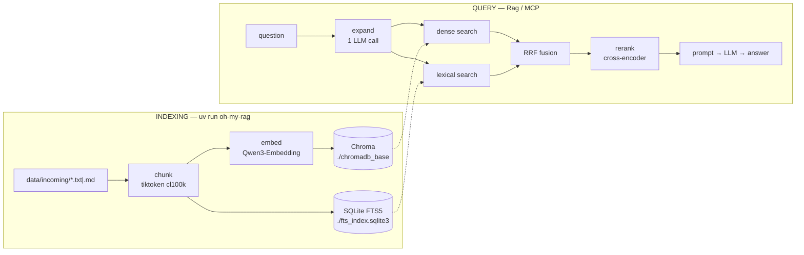

# How oh-my-rag works

A question asked here is answered from **your** documents only. Nothing leaves the
machine: the embedding model, the vector index, the keyword index and the language model
all run locally.

This document walks the whole system, in execution order, with a link to the exact line
of code behind each step.

---

## The shape of it

There are **two pipelines** and **three stores**.

The pipelines never run in the same process. You seed the index when documents change,
then query it as often as you like. What joins them is a single string — the *chunk uid* —
which names the same passage in both stores. Fusion depends entirely on that.



| Store | Path | Written by | Read by |
| --- | --- | --- | --- |
| Vector index | `./chromadb_base` | [index_chunks (seed_database.py:30)](src/oh_my_rag/seed_database.py#L30) | [VectorSearch.search (search/vector.py:38)](src/oh_my_rag/search/vector.py#L38) |
| Full-text index | `./fts_index.sqlite3` | [FtsIndex.upsert (search/fts.py:144)](src/oh_my_rag/search/fts.py#L144) | [FtsIndex.search (search/fts.py:188)](src/oh_my_rag/search/fts.py#L188) |
| Chunk cache | `chunks.pkl` | [seed_database (seed_database.py:72)](src/oh_my_rag/seed_database.py#L72) | *nothing — see [Known gaps](#known-gaps)* |

All three are gitignored. A fresh clone must be seeded before it can answer anything.

---

## Part 1 — Indexing

Entry point: `uv run oh-my-rag` → [main (__init__.py:3)](src/oh_my_rag/__init__.py#L3) → [seed_database (seed_database.py:72)](src/oh_my_rag/seed_database.py#L72).

### 1.1 Load the documents

[load (documents_loader.py:13)](src/oh_my_rag/documents_loader.py#L13) walks `DATA_SOURCE_DIR` recursively and reads every file whose
suffix is in `supported_formats` (`.txt`, `.md`). Each becomes a
[Document (documents_loader.py:7)](src/oh_my_rag/documents_loader.py#L7) holding its path and full text.

The path stored here is *relative* (`data/incoming/notes.md`). That matters later: it
becomes half of the chunk uid, so an absolute path would produce a different uid and
silently duplicate the document on the next reseed.

### 1.2 Split into chunks

[build_chunks_from_docs (build_chunks.py:37)](src/oh_my_rag/build_chunks.py#L37) runs each document through
[build_chunks_from_text (build_chunks.py:22)](src/oh_my_rag/build_chunks.py#L22), which tokenizes with tiktoken's `cl100k_base`
and slides a `CHUNK_SIZE`-token window forward by `CHUNK_SIZE - CHUNK_OVERLAP` each step.
Chunking on *tokens* rather than characters keeps every chunk within a predictable budget
for the embedding model.

Each piece becomes a [Chunk (build_chunks.py:8)](src/oh_my_rag/build_chunks.py#L8) carrying its index within the document and a
back-reference to the source.

### 1.3 The uid — the single most important line

[Chunk.uid (build_chunks.py:14)](src/oh_my_rag/build_chunks.py#L14) returns `f"{self.src.path}::{self.chunk_id}"`.

This one string is Chroma's document id **and** FTS5's `chunk_uid`. Reciprocal rank
fusion matches a keyword hit to a vector hit by comparing these strings, so the two
stores must generate them identically. It is defined once, as a property, and never
rebuilt inline anywhere else.

### 1.4 Write both stores

[index_chunks (seed_database.py:30)](src/oh_my_rag/seed_database.py#L30) is the only function that writes an index. Both seeding
and the MCP `write_doc` tool go through it, so the two stores cannot drift apart.

It embeds every chunk client-side with [get_embedding_model (embeddings_model_loader.py:8)](src/oh_my_rag/embeddings_model_loader.py#L8),
then performs two upserts keyed on the same uid — Chroma first, FTS5 second. Because both
are upserts, re-running the seed after a partial failure is the repair.

`--rebuild` drops both: the Chroma collection in [get_collection (seed_database.py:17)](src/oh_my_rag/seed_database.py#L17) and the
FTS tables in [FtsIndex.drop (search/fts.py:173)](src/oh_my_rag/search/fts.py#L173).

### 1.5 Inside the full-text index

[FtsIndex._ensure_schema (search/fts.py:80)](src/oh_my_rag/search/fts.py#L80) creates three tables:

- **`chunks_fts`** — an FTS5 virtual table over `text`, with `chunk_uid` and `src` marked
  `UNINDEXED` so they are stored and returned but never searched.
- **`chunk_rows`** — a plain `chunk_uid → rowid` map. FTS5 *cannot* index an `UNINDEXED`
  column, so deleting a chunk by uid would otherwise scan the entire table. This side
  table turns a re-seed into a rowid lookup. [FtsIndex.upsert (search/fts.py:144)](src/oh_my_rag/search/fts.py#L144) uses it to delete the
  old row before inserting the new one.
- **`fts_meta`** — the tokenizer and schema version the index was built with.
  [FtsIndex._check_meta (search/fts.py:117)](src/oh_my_rag/search/fts.py#L117) refuses to write into an index whose tokenizer differs from
  the current config, because that mismatch produces no error of its own — it just ranks
  against differently-tokenized text.

The connection is opened in WAL mode in [FtsIndex._conn (search/fts.py:59)](src/oh_my_rag/search/fts.py#L59), which lets a search read
while an MCP `write_doc` is committing.

**About the tokenizer.** `porter unicode61 remove_diacritics 2` stems English. Measured
against this SQLite build, inflections merge reliably — `retrieve` matches
retrieves/retrieved/retrieving, `policy` matches policies. Derivations are inconsistent:
`retrieval`, `connection`, `computation` and `connectivity` *do* merge with their verbs,
while `accrual`, `deployment`, `runner` and `policing` do **not**. That is why
[SYSTEM_PROMPT (query_expansion.py:79)](src/oh_my_rag/query_expansion.py#L79) asks the model for *key nouns* rather than terms.

---

## Part 2 — Querying

Entry points: `uv run oh-my-rag-chat` → [main (runners/cli.py:128)](src/oh_my_rag/runners/cli.py#L128) → [Rag.answer (rag.py:166)](src/oh_my_rag/rag.py#L166), or the MCP tool
[search_docs (mcp/server.py:151)](src/oh_my_rag/mcp/server.py#L151).

The full path is [Rag.answer_verbose (rag.py:169)](src/oh_my_rag/rag.py#L169): expand → search → prompt → generate, returning
a [RagResult (rag.py:25)](src/oh_my_rag/rag.py#L25) that carries every intermediate value so `--debug` and MCP responses can
show their work.

### 2.1 Expand the question

[expand (query_expansion.py:188)](src/oh_my_rag/query_expansion.py#L188) makes one LLM call asking for three tagged lines: comma-separated
keywords, and two rephrasings. The system prompt at [SYSTEM_PROMPT (query_expansion.py:79)](src/oh_my_rag/query_expansion.py#L79) is
deliberately three lines long — every extra instruction is another thing a 4-bit 1.7B model
can drift on.

The reply is parsed by [parse_expansion (query_expansion.py:170)](src/oh_my_rag/query_expansion.py#L170) using three **independent**
regexes ([_KEYWORDS_RE (query_expansion.py:90)](src/oh_my_rag/query_expansion.py#L90) and the two `ALT` patterns), so a mangled `ALT2`
costs you `ALT2` and nothing else.

**The salvage path.** Qwen3-1.7B frequently answers with the right content in the wrong
shape — `AP2, UCP` instead of `KEYWORDS: AP2, UCP`. Discarding that would cost the entire
lexical branch, so [_looks_like_a_keyword_list (query_expansion.py:152)](src/oh_my_rag/query_expansion.py#L152) recognises a reply that is
*structurally* a keyword list (short, comma-separated, no part long enough to be a sentence)
and treats it as keywords. This took expansion success from 1-in-5 to 5-in-5 on the local
model. Prose without commas is still rejected.

Everything is then bounded by [_clean_keywords (query_expansion.py:113)](src/oh_my_rag/query_expansion.py#L113) and
[_clean_alternates (query_expansion.py:131)](src/oh_my_rag/query_expansion.py#L131): keywords deduped and capped at
`EXPANSION_MAX_KEYWORDS`, alternates that merely echo the question dropped, hard length
limits on both.

The result is an [ExpandedQuery (query_expansion.py:50)](src/oh_my_rag/query_expansion.py#L50), which routes itself:

- [ExpandedQuery.vector_queries (query_expansion.py:68)](src/oh_my_rag/query_expansion.py#L68) → `[original, *alternates]`, for the dense branch.
- [ExpandedQuery.fts_terms (query_expansion.py:72)](src/oh_my_rag/query_expansion.py#L72) → the keywords, or, if there are none,
  [tokenize (query_expansion.py:29)](src/oh_my_rag/query_expansion.py#L29) applied to the raw question — content words with stopwords
  removed, but identifiers like `AP2`, `C++` and `bge-small` left intact.

### 2.2 Run both retrievers at once

[HybridSearch.search (search/hybrid.py:63)](src/oh_my_rag/search/hybrid.py#L63) submits both branches to a long-lived two-thread pool
created in [HybridSearch.__init__ (search/hybrid.py:34)](src/oh_my_rag/search/hybrid.py#L34).

They genuinely overlap rather than time-slice: SQLite, Chroma's HNSW and torch all release
the GIL inside their own native work. Measured cost of adding the lexical branch: **+0.3 ms
median (+4%)**, of which the FTS query itself is ~0.1 ms — the rest is pool overhead. The
pool is kept alive across queries so its threads retain their SQLite connections.

Each branch is settled independently by [HybridSearch._settle (search/hybrid.py:54)](src/oh_my_rag/search/hybrid.py#L54). If FTS5 fails you
get pure vector search — exactly the pre-hybrid behaviour. If Chroma fails you still get
keyword results. Neither can take the other down.

### 2.3 The dense branch

[VectorSearch.search (search/vector.py:38)](src/oh_my_rag/search/vector.py#L38) prefixes every query variant with
[EMBEDDING_QUERY_PREFIX (config.py:30)](src/oh_my_rag/config.py#L30) — the model's own query-side instruction, deliberately *not* applied to
documents — embeds them in one batch, and sends them as a **single** Chroma call.

Three phrasings therefore cost one round trip and one batched encode, coming back as three
separate ranked lists. Measured with `Qwen3-Embedding-0.6B`: 30 ms for one query, 162 ms for
three — the encode dominates, so alternates are cheap rather than free. (With the much
smaller `bge-small` they were nearly free at 7 ms.) Either way it is noise beside a
~25-second generation.

### 2.4 The lexical branch

[FtsIndex.search (search/fts.py:188)](src/oh_my_rag/search/fts.py#L188) runs `bm25()` over the FTS5 table, ordered **ascending** — SQLite's
`bm25()` returns a negative number, so smaller is a better match.

The expression is built by [build_match_expr (search/fts.py:18)](src/oh_my_rag/search/fts.py#L18), which is the sharp edge of the whole
system: keywords arrive from an LLM, and FTS5 treats `-`, `:`, `*`, `"`, `(`, `)`, `OR`,
`NOT` and `NEAR` as query syntax. Each term is wrapped in double quotes, making it a phrase
literal — safe, and the right meaning for a multi-word keyword. Terms with no alphanumeric
character are dropped rather than producing an empty `MATCH`.

If the expression still fails, [FtsIndex.search (search/fts.py:188)](src/oh_my_rag/search/fts.py#L188) catches `sqlite3.OperationalError`,
logs it and returns `[]`. A bad keyword can cost you the lexical half of a search, never the
whole query.

### 2.5 Fuse the rankings

[reciprocal_rank_fusion (search/fusion.py:16)](src/oh_my_rag/search/fusion.py#L16) computes `score(d) = Σ wᵢ / (k + rankᵢ(d))` across every
list and keeps the best `TOP_K`.

**Only ranks are read.** Chroma distances and BM25 scores live on incomparable scales, and
normalising them into one number is guesswork that shifts with every corpus. Dropping the
scores sidesteps that entirely — which matters most here, where the dense model is small and
its scores are not especially trustworthy.

Lists arrive as [RankedList (search/fusion.py:8)](src/oh_my_rag/search/fusion.py#L8) values carrying a name and a weight, assembled in
[HybridSearch.search (search/hybrid.py:63)](src/oh_my_rag/search/hybrid.py#L63):

| List | Weight | Why |
| --- | --- | --- |
| `vector` (original question) | `RRF_WEIGHT_VECTOR` = 1.0 | the user's actual words |
| `vector_alt1`, `vector_alt2` | `RRF_WEIGHT_ALTERNATE` = 0.7 | the model's paraphrase — a vote, but quieter |
| `fts` | `RRF_WEIGHT_FTS` = 1.0 | exact-term evidence |

Chunks are deduped on uid, and ties break on uid so the ordering is stable across runs
rather than dictionary-order luck. Each surviving [FusedHit (search/types.py:22)](src/oh_my_rag/search/types.py#L22) carries a `sources`
map of *which retriever found it at what rank* — this is what `--debug` prints and what MCP
returns as `matched_by`.

The payoff, from a real `--debug` session:

```
1. UCP-andAP2.md::0           score=0.03252  [fts@2, vector@1]
5. UCP-specification.md::36   score=0.02938  [fts@1, vector@17]
```

Slot 5 was rank **17** in the dense list and rank **1** in the lexical one. Vector search
alone had buried it; fusion pulled it into the answer.

### 2.6 Rerank the survivors

Fusion ranks by *agreement between retrievers*, which is a proxy for relevance, not
relevance itself. Both retrievers compare things computed independently — a query vector
against passage vectors, query terms against an inverted index — so neither ever looks at
the question and a passage **together**.

[Reranker (search/rerank.py:13)](src/oh_my_rag/search/rerank.py#L13) does. A cross-encoder feeds the pair through one model and scores it
jointly, which is why it reorders usefully and why it is far too slow to run over a whole
corpus. It belongs exactly here: last, over a short list.

With reranking on, fusion hands over `RERANK_CANDIDATES` instead of `TOP_K`, and the
cross-encoder makes the final cut. It only ever reorders what retrieval already found.

Measured on this corpus, over questions built from rare identifiers — the case a bigger
semantic embedding model is *worst* at:

| MRR@3 | RRF only | + reranker |
| --- | --- | --- |
| natural-language questions | 1.000 | 1.000 |
| rare identifiers | 0.403 | **0.611** |

It costs about 3 seconds. The single biggest factor is not the candidate count but the
model's `max_seq_length`, which defaults to **40960** tokens — vastly more than a
`CHUNK_SIZE`-token passage needs. Pinning it to `RERANK_MAX_TOKENS` took 20 candidates from
8244 ms to 5281 ms at 512 and 2591 ms at 256, with the ordering essentially unchanged.

Like every other stage, it degrades rather than fails: a model error leaves the fused
ordering intact, and `RERANK_ENABLED = False` skips the model load entirely.

### 2.7 Build the prompt and generate

[Rag.build_prompt (rag.py:115)](src/oh_my_rag/rag.py#L115) wraps the question and the fused chunks in XML-ish tags, emitting
each chunk as a delimited `<doc src="...">` block. (Earlier this joined chunks with `""`,
which ran the last sentence of one document straight into the filename of the next.)

[Rag.ask_llm (rag.py:130)](src/oh_my_rag/rag.py#L130) hands it to [chat (llm_client.py:49)](src/oh_my_rag/llm_client.py#L49), which POSTs to an OpenAI-compatible
`/chat/completions` endpoint, non-streaming, and cleans the reply with
[strip_control_tokens (llm_client.py:35)](src/oh_my_rag/llm_client.py#L35).

**Scrubbing a reasoning model's output is fiddlier than it looks.** Qwen3 writes its
scratchpad inline, and a 4-bit quantization writes it sloppily. Three shapes all occur:

| Shape | Example | Why it happens |
| --- | --- | --- |
| matched pair | `<think>a</think>answer` | the common case |
| **orphan close** | `a</think>answer` | the opening tag never arrived — the chat template pre-filled it, or the model skipped it. Everything before the tag is scratchpad. |
| orphan open | `<think>a` | `max_tokens` cut the thought short |

A pattern that requires a matched pair cannot see the orphan close, so both the tag *and*
the reasoning before it reach the user — the bug this handling exists to prevent. Tags are
matched case-insensitively and tolerate whitespace inside the brackets. Stop tokens `</s>`
and `<|im_end|>` are removed afterwards.

**Always send `max_tokens`.** mlx-lm caps completions at **512 tokens** when a request
omits it, which truncates answers mid-sentence. `LLM_MAX_TOKENS` covers the answer path.

**Reasoning shares that budget, and that is the trap when you upgrade the model.** At
`EXPANSION_MAX_TOKENS = 200`, qwen3.5:9b spent every one of those tokens thinking and
returned empty content — so all five test expansions fell back, each after 12 seconds of
wasted work. Setting `reasoning_effort` to `"none"` fixed it: 3.6s and 5/5, now with
alternates the 1.7B never produced. The same applies to answering, where the scratchpad
buys nothing for grounded extraction: **23.0s with reasoning off versus 87.7s on**, for
answers of equivalent quality, with one question exceeding `LLM_TIMEOUT` outright.

Two backends, two shapes. Ollama returns the scratchpad in a separate `message.reasoning`
field, so `content` is already clean; mlx-lm inlines it as `<think>` tags, which is why the
scrubbing above exists. Neither `think=False` nor a `/no_think` suffix is honoured by
Ollama's OpenAI endpoint — `reasoning_effort` is.

### 2.8 Watching it work

Retrieval that cannot be inspected cannot be tuned, so every stage can record itself into a
[Trace (observability.py:23)](src/oh_my_rag/observability.py#L23) — timings, each retriever's ranked list, the FTS MATCH expression
with how many chunks it matched before `LIMIT`, and the fused result with its arithmetic.

It is deliberately **data, not printing**: [render_trace (runners/cli.py:114)](src/oh_my_rag/runners/cli.py#L114) formats it for the terminal,
and an MCP or web frontend could consume the same object. Tracing is opt-in via
[Rag.prepare (rag.py:140)](src/oh_my_rag/rag.py#L140), and [HybridSearch.search (search/hybrid.py:63)](src/oh_my_rag/search/hybrid.py#L63) hands a branch recorder to the
lexical retriever only while tracing, so a retriever implementing the minimal
`search(terms, limit)` contract keeps working.

`uv run oh-my-rag-chat --debug` renders it, and the numbers are worth looking at:

```
── expansion ───────────────────────────────── 3.82s
── retrieval ──────────────────── 219ms wall, 2 threads
── answer ──────────────────────────────── streaming
  first token 17.68s  ·  332 chars in 21.18s
```

Retrieval — the part this whole system is about — costs **219 ms**. The expansion round trip
costs 3.8s, and the first generated token takes 17.7s because the prompt is ~16,000
characters and that is prompt *prefill*, not generation. `TOP_K` and `CHUNK_SIZE` set that
prompt size, so they are the latency dials, not anything in `search/`.

### 2.9 Streaming

[Rag.prepare (rag.py:140)](src/oh_my_rag/rag.py#L140) and [Rag.stream_answer (rag.py:184)](src/oh_my_rag/rag.py#L184) are separate so a frontend can show
retrieval before generation begins. [chat_stream (llm_client.py:223)](src/oh_my_rag/llm_client.py#L223) reads the SSE stream and
yields `delta.content` only — Ollama's separate `delta.reasoning` is ignored, matching the
non-streaming path.

Scrubbing a scratchpad from a stream is harder than from a finished string, because a
`<think>` block cannot be removed until its closing tag arrives and a tag can be split
across two deltas. [StreamScrubber (llm_client.py:120)](src/oh_my_rag/llm_client.py#L120) never emits past a trailing `<` that might
begin a tag, which also means ordinary prose streams with zero delay. One case it cannot
fully fix is an orphan `</think>` arriving after text has already been printed — nothing
un-prints it — so `probation` optionally buffers the opening characters, and `Rag` sets it
to zero when `LLM_REASONING_EFFORT` is `"none"` and no scratchpad can exist. Fuzzed against
the batch path over randomly split deltas, streamed output matches
[strip_control_tokens (llm_client.py:35)](src/oh_my_rag/llm_client.py#L35) on every shape.

### 2.10 The usage log

The `Trace` above lives and dies with one question. [UsageLog (usage_log.py:32)](src/oh_my_rag/usage_log.py#L32) is the durable
counterpart: every LLM call is appended to `./llm_usage.sqlite3`, a **fourth** store kept
separate from the three retrieval ones so it can be rotated or deleted freely.

Recording happens inside [chat (llm_client.py:49)](src/oh_my_rag/llm_client.py#L49) and [chat_stream (llm_client.py:223)](src/oh_my_rag/llm_client.py#L223) — the single
choke point every call passes through — so a new frontend is logged automatically and need
only pass a `kind`. Failures are recorded *before* the exception propagates, because a
timeout or a refused connection is exactly the traffic worth being able to count.

Two details the OpenAI shape forces:

- A streamed response carries **no usage block** unless the request asks for it, so
  `chat_stream` sends `stream_options={"include_usage": True}`. That block arrives as a
  final chunk with no `choices` at all, which is why the reader checks for it separately.
- Token counts are `NULL` whenever the server reports none. `prompt_chars` is computed
  locally and always stored, so no row is ever useless.

`uv run python -m oh_my_rag.usage_log` prints per-kind totals. The first thing it shows is
that **a question costs two LLM calls, not one** — expansion and answering — and that they
differ in shape: answering sends 1 message, expansion sends 2 (a system prompt and the
question). Both are single-turn; neither is a conversation.

---

## Part 3 — When things go wrong

Query expansion is the one step that talks to a language model before search, so it is the
one most able to misbehave. [expand (query_expansion.py:188)](src/oh_my_rag/query_expansion.py#L188) guarantees it returns an
`ExpandedQuery` — it never raises, never returns `None`, never propagates an HTTP error.

| Failure | Detected by | Result |
| --- | --- | --- |
| LLM server down | `requests.ConnectionError` | full fallback |
| Slow / hung generation | `EXPANSION_TIMEOUT` | full fallback |
| Empty reply, or all `<think>` | length check after [strip_control_tokens (llm_client.py:35)](src/oh_my_rag/llm_client.py#L35) | full fallback |
| Prose with no tagged lines | all three regexes miss, salvage declines | full fallback |
| Untagged `a, b, c` list | [_looks_like_a_keyword_list (query_expansion.py:152)](src/oh_my_rag/query_expansion.py#L152) | **salvaged** as keywords |
| `KEYWORDS` only, no `ALT`s | two regexes miss | partial — dense side uses the original alone |
| Punctuation-only keywords | alnum filter in [build_match_expr (search/fts.py:18)](src/oh_my_rag/search/fts.py#L18) | partial — lexical returns `[]` |
| Too many keywords/alternates | caps in [_clean_keywords (query_expansion.py:113)](src/oh_my_rag/query_expansion.py#L113) | truncated |

A *full fallback* means the pipeline runs on the untouched question — precisely the
behaviour before expansion existed. Every fallback logs its reason via
[_fallback (query_expansion.py:246)](src/oh_my_rag/query_expansion.py#L246), and `expanded=False` travels with the query so `--debug` and
MCP responses can distinguish a real expansion from a fallback. Silent degradation is what
makes retrieval quality impossible to reason about later.

---

## Part 4 — The MCP surface

[mcp (mcp/server.py:15)](src/oh_my_rag/mcp/server.py#L15) exposes the corpus over the Model Context Protocol, on stdio by default and
streamable HTTP with `--http` ([main (mcp/server.py:195)](src/oh_my_rag/mcp/server.py#L195)).

| Tool | Code | Notes |
| --- | --- | --- |
| `list_docs` | [list_docs (mcp/server.py:73)](src/oh_my_rag/mcp/server.py#L73) | indexable files with sizes |
| `read_doc` | [read_doc (mcp/server.py:98)](src/oh_my_rag/mcp/server.py#L98) | full text of one file |
| `write_doc` | [write_doc (mcp/server.py:116)](src/oh_my_rag/mcp/server.py#L116) | writes **and indexes**, searchable immediately |
| `search_docs` | [search_docs (mcp/server.py:151)](src/oh_my_rag/mcp/server.py#L151) | ranked passages, not a generated answer |

Three deliberate choices:

**`search_docs` returns chunks, not prose.** The host that called the tool already has its
own, larger model in the loop. Handing it ranked passages plus `src`, `chunk_uid` and
`matched_by` lets it reason over the evidence; handing it a paragraph from a 1.7B model
throws that away.

**Every path is confined.** [_resolve (mcp/server.py:57)](src/oh_my_rag/mcp/server.py#L57) resolves the caller's path against the
corpus root and rejects anything that is not inside it. Because `Path.resolve()` collapses
`..` *and* follows symlinks before the check, neither traversal nor a symlink pointing
outside can escape. `write_doc` additionally enforces the `.txt`/`.md` allow-list.

**Nothing heavy loads at import.** [_get_rag (mcp/server.py:33)](src/oh_my_rag/mcp/server.py#L33) and [_get_fts (mcp/server.py:42)](src/oh_my_rag/mcp/server.py#L42) are lazy: an
MCP host spawns this over stdio and expects a fast handshake, and loading
sentence-transformers during startup risks a timeout.

**Diagnostics go to stderr, never stdout.** Under the stdio transport, stdout *is* the
JSON-RPC channel. A single stray `print()` — say the one-line notice from
[_fallback (query_expansion.py:246)](src/oh_my_rag/query_expansion.py#L246) when expansion degrades — lands in the middle of a protocol
frame and kills the request with a `JSONRPCMessage` validation error. Every diagnostic in
[expand (query_expansion.py:188)](src/oh_my_rag/query_expansion.py#L188), [FtsIndex.search (search/fts.py:188)](src/oh_my_rag/search/fts.py#L188) and [HybridSearch._settle (search/hybrid.py:54)](src/oh_my_rag/search/hybrid.py#L54)
passes `file=sys.stderr`. CLI output under `runners/` and in [seed_database (seed_database.py:72)](src/oh_my_rag/seed_database.py#L72)
stays on stdout, because those never run under MCP.

`write_doc` reuses [index_chunks (seed_database.py:30)](src/oh_my_rag/seed_database.py#L30) on a one-document list and stores the
*relative* path, so the uid it produces is byte-identical to what a full reseed produces —
verified, because otherwise every MCP-written document would silently duplicate on the next
`uv run oh-my-rag`.

The client half is [make_client (mcp/client.py:16)](src/oh_my_rag/mcp/client.py#L16), with `oh-my-rag-mcp-call` as a thin CLI
([main (mcp/client.py:31)](src/oh_my_rag/mcp/client.py#L31)) for poking at the server by hand.

---

## Part 5 — Invariants that break silently

These are the ones that produce no error, just worse answers.

**Both sides must embed with the same model.** [index_chunks (seed_database.py:30)](src/oh_my_rag/seed_database.py#L30) and
[VectorSearch.search (search/vector.py:38)](src/oh_my_rag/search/vector.py#L38) both call [get_embedding_model (embeddings_model_loader.py:8)](src/oh_my_rag/embeddings_model_loader.py#L8).
If `upsert()` were ever called with `documents=` but no `embeddings=`, Chroma would quietly
fall back to its own bundled default model. At 384 dimensions that now collides with a
1024-dimensional collection and raises — but the failure was **silent** back when
`EMBEDDING_MODEL` was itself 384-dimensional, and would be silent again for any model of
matching width. Do not rely on the dimension check to catch it.

**Both sides must normalize.** Both pass `normalize_embeddings=True`. The collection's
index uses the l2 space, which ranks identically to cosine *only* for normalized vectors —
and both bge-* and Qwen3-Embedding are trained for cosine.

**The query prefix is asymmetric on purpose.** [EMBEDDING_QUERY_PREFIX (config.py:30)](src/oh_my_rag/config.py#L30) is applied
to questions and never to documents. That is the convention of every instruction-tuned
retrieval model, not an oversight — and it lives beside [EMBEDDING_MODEL (config.py:22)](src/oh_my_rag/config.py#L22) because
each family words it differently. Qwen3-Embedding's string is copied verbatim from the
model's own `config_sentence_transformers.json`, down to the missing space after `Query:`;
bge phrases it entirely differently. Swapping the model without swapping this raises
nothing and quietly costs you retrieval quality.

**The tokenizer is baked into the index.** Changing `FTS_TOKENIZER` requires
`uv run oh-my-rag --rebuild`. [FtsIndex._check_meta (search/fts.py:117)](src/oh_my_rag/search/fts.py#L117) enforces this rather than
trusting you to remember.

**Changing `EMBEDDING_MODEL` requires a rebuild too**, for the same reason.

---

## Part 6 — Configuration

Everything is module-level constants in [config.py](src/oh_my_rag/config.py) — no env vars,
no `.env`, no CLI overrides beyond the two seeding flags.

| Group | Constants |
| --- | --- |
| LLM | `LLM_BASE_URL`, `LLM_MODEL`, `LLM_TIMEOUT` |
| Embeddings | `EMBEDDING_MODEL` |
| Chunking | `CHUNK_SIZE`, `CHUNK_OVERLAP`, `CHUNKS_PATH` |
| Stores | `CHROMADB_PATH`, `DATA_SOURCE_DIR`, `FTS_PATH`, `FTS_TOKENIZER` |
| Expansion | `EXPANSION_ENABLED`, `EXPANSION_MODEL`, `EXPANSION_TIMEOUT`, `EXPANSION_MAX_TOKENS`, `EXPANSION_MAX_KEYWORDS`, `EXPANSION_MAX_ALTERNATES`, `EXPANSION_NO_THINK` |
| Retrieval | `TOP_K`, `CANDIDATE_K`, `SEARCH_TIMEOUT` |
| Fusion | `RRF_K`, `RRF_WEIGHT_VECTOR`, `RRF_WEIGHT_ALTERNATE`, `RRF_WEIGHT_FTS` |
| MCP | `MCP_SERVER_NAME`, `MCP_HTTP_PORT` |

Two worth understanding:

**`CANDIDATE_K` vs `TOP_K`.** Each retriever returns `CANDIDATE_K` (20) candidates; fusion
returns `TOP_K` (5). Fusion needs more candidates than it returns or there is nothing to
fuse. The flip side: on a corpus of only ~60 chunks, 20 candidates per branch is a third of
everything, the two branches overlap almost entirely, and fusion has little to discriminate.
Hybrid search earns its keep as the corpus grows.

**`EXPANSION_NO_THINK`.** Measured against `mlx-community/Qwen3-1.7B-4bit`: with the
`/no_think` switch on, 5/5 expansions succeeded at 369 ms mean; off, 4/5 at 887 ms. Faster
*and* more compliant. The cost is that with reasoning off the model rarely emits `ALT`
lines, so expansion contributes keywords more than extra dense queries. Set it `False` to
trade latency for alternates.

---

## Known gaps

- **`--from-cache` does nothing.** It is parsed in [parse_args (seed_database.py:98)](src/oh_my_rag/seed_database.py#L98) and threaded
  into [seed_database (seed_database.py:72)](src/oh_my_rag/seed_database.py#L72), but the body ignores it. `chunks.pkl` is written on
  every seed and never read back.
- **A plain reseed never removes deleted documents.** Chunks whose source file is gone
  survive in both stores until `--rebuild`. The two stores behave identically here, on
  purpose — diverging would create drift rather than fix it.
- **No test suite, linter or formatter** is configured. Verification is by the scripts in
  the design plan's phase gates.

---

## Extending it

**A new frontend.** Write a module under `runners/` against the [Rag (rag.py:36)](src/oh_my_rag/rag.py#L36) class, the way
[main (runners/cli.py:128)](src/oh_my_rag/runners/cli.py#L128) does. Nothing below `Rag` needs to know about it.

**A new retriever.** Return a list of [SearchHit (search/types.py:5)](src/oh_my_rag/search/types.py#L5) values with 1-based ranks, wrap it in a
[RankedList (search/fusion.py:8)](src/oh_my_rag/search/fusion.py#L8) with a name and weight, and add it to the list assembled in
[HybridSearch.search (search/hybrid.py:63)](src/oh_my_rag/search/hybrid.py#L63). Fusion does not care where a list came from.

**A new document type.** Add the suffix to `supported_formats` in
[documents_loader.py](src/oh_my_rag/documents_loader.py) and teach [load (documents_loader.py:13)](src/oh_my_rag/documents_loader.py#L13)
how to read it. Everything downstream works on plain text.

**Reranking.** The natural next quality lever: run a cross-encoder over the fused `TOP_K`
before [Rag.build_prompt (rag.py:115)](src/oh_my_rag/rag.py#L115). It costs a second model and real latency, which is why it
is not here.

See [DESIGN.md](DESIGN.md) for the design rationale, the phase plan and the measurements
behind the numbers quoted above.
